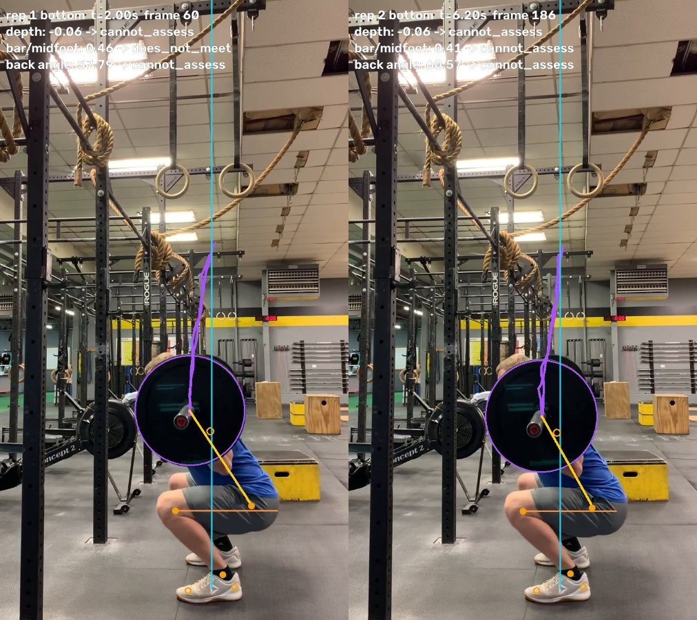
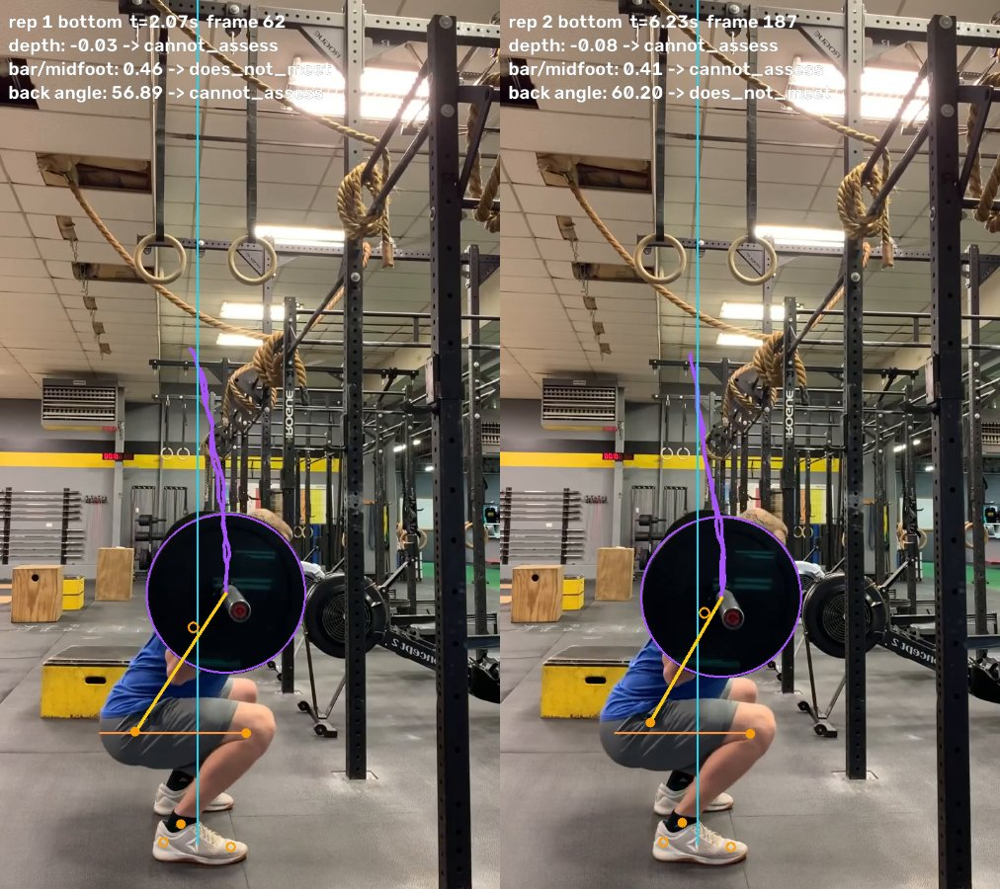
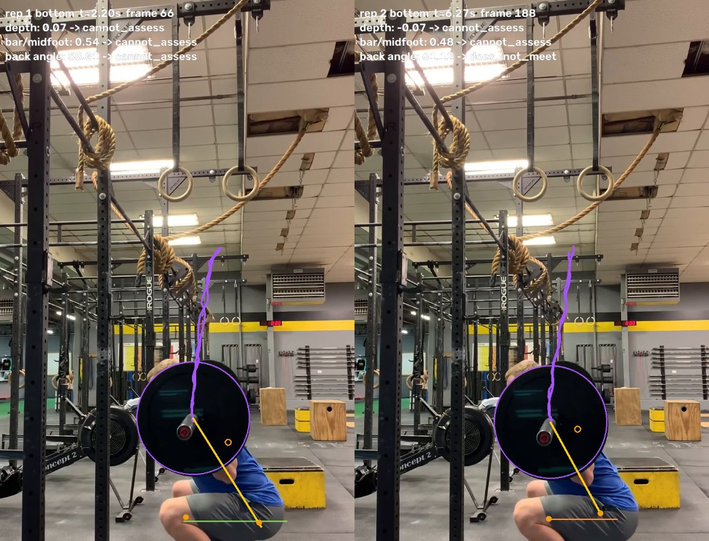

# Evidence

All runs use the same pipeline as the web app (`python -m tools.analyse_file`),
rulebook v1. ✓ meets · ✗ does not meet · ? cannot assess.

## Common sample (assignment video)

Source: `youtube.com/shorts/TRvg083BrXY` (link in the assignment PDF, page 1),
1080×1920, 30 fps, 7.9 s, two reps, lifter facing left, camera close to square.

*Purple: bar path (plate centre) and plate circle. Cyan: midfoot line. Orange
line: knee height (green if the hip is below it). Yellow: torso line used for
the back angle. Filled dots = seen; hollow = estimated.*

| Check (reference pages) | Rep 1 | Rep 2 | Notes |
|---|---|---|---|
| Hips below top of knee (2, 15, 33, 35) | ? | ? | Hip ≈ 2 cm above the knee joint, but the two pose passes range from 7 cm above to 2.5 cm below: too close to call |
| Bar over midfoot (8, 9, 11, 32) | ✗ | ? | Bar ≈ 0.46 foot lengths (~9 cm) in front of midfoot; over midfoot when standing. Rep 2 (~8 cm) sits on the edge of the camera-angle margin |
| Bar path vertical (6, 7) | ✗ | ✗ | ≈ 0.46-0.50 foot lengths (9-10 cm) of forward/back travel; both pose passes agree |
| Back angle about 45° (22, 33, 35) | ? | ? | 58° and 61° from the floor (passes: 57-64°). The app reads "about 45°" as 35-55°; this is above it but within the measurement margin |
| Knees a little in front of toes (17, 22) | ✓ | ? | |
| Hips drive up first (22, 23, 32, 35) | ✓ | ✓ | Torso turns < 4° more upright in the first third of the ascent |
| Heels down (22, 24) | ? | ? | Heel rise ≈ 0.03 foot lengths: small, but inside the noise band |
| No pause at the bottom (16, 32) | ? | ✓ | 0.50 s and 0.37 s near the bottom |

**Bottom line for this lifter:** the clearest, best-supported finding is that
the bar drifts forward of the midfoot and doesn't travel in a vertical line
(reference pp. 6, 11). Depth and back angle are close to the limits and the
app declines to call them rather than guess.

**AI coach output (Gemini 3.8 Flash, from the rulebook):**

> You completed 2 reps with strong hip drive and a quick turnaround out of the
> bottom. The main issue is bar path: the bar drifted forward of your midfoot
> instead of traveling in a straight vertical line. We could not reliably
> assess depth, heels staying down, or back angle due to measurement limits,
> and a side view cannot check stance width or knees shoved out.

Top priorities it chose: *bar path vertical* (cue from p. 6) and *bar over
midfoot* (cue from p. 11). Validator: 0 of 16 feedback items dropped, meaning
every page it cited is one the criterion cites. One issue found and fixed via
the skill: the coach quoted the rulebook's base margin (0.05) instead of the
finding's real margin (0.168). A one-line instruction in `SKILL.md` fixed it,
with no code change.

**What was checked by eye:** hip, knee, ankle, heel and toe points on the
bottom frames; the plate circle matches the plate in every frame (bar measured
in 100% of frames: 221 circle detections, 15 appearance-tracked blurred frames);
standing vs bottom frames show the bar moving from over the middle of the
shoe to over the toes, so the forward-drift finding is real.

## Difficult and unsuitable clips

Generated from the sample with `python -m tools.make_hard_videos`, each to
exercise one failure path. (A second real lifter would be a better test; any
side-view squat video can be uploaded the same way.)

| Clip | What it tests | Result |
|---|---|---|
| `mirrored.mp4` | Lifter faces the other way. Results should match the original | No check flips between ✓ and ✗. A few results that sit at a limit move between "can't assess" and ✓ or ✗ (e.g. rep 2 back angle: 60.5° "?" vs 60.2° "✗").  |
| `feet_cropped.mp4` | Bottom 14% cut off: feet out of the picture | Warning shown; bar-over-midfoot, knee-vs-toe and heel checks become "cannot assess"; 2 reps found (an earlier version found a phantom 3rd rep).  |
| `dark_blurry.mp4` | Dark, blurred, one-third size | **Rejected**: "too dark; too blurry", with re-recording tips. Before the quality gate it produced confident fails that were wrong. |
| `no_squat.mp4` | A still standing clip, no rep | **Rejected**: "We couldn't find a full squat rep". |
| Re-encoded sample, uploaded through the browser | Same lifter, extra compression: how stable are the results? | Same ✓/✗ on every clear-cut check. The two values sitting on a limit (rep 2 bar over midfoot, rep 2 back angle) read ✗ instead of ?. Expected: values at a limit can move between "?" and a verdict, but never from ✓ to ✗. |

### Consistency summary

Across the original, the mirrored copy and the re-encoded upload, no check
ever changed between ✓ and ✗. The only changes are at a limit, between "?" and
a verdict. Bar measurements agree to within ±0.03 foot lengths (under 1 cm).

## Source grounding

* Every criterion in `criteria.yaml` cites reference pages; `tests/test_rules.py`
  checks every page is within 1-35 and every non-assessable criterion has a
  reason.
* Thresholds the document doesn't give are tagged `app_interpretation` and
  shown with an "app interpretation" tag in the report.
* The coach's output is validated: unknown (rep, check) pairs and page numbers
  the criterion doesn't cite are dropped (unit-tested).
